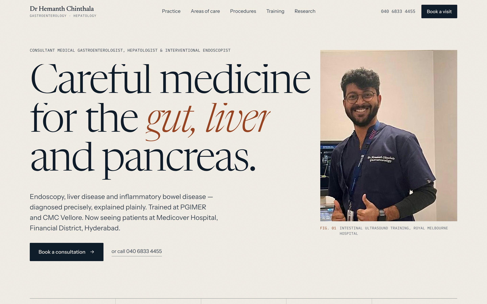

# Dr Hemanth Chinthala: website

A single-page website for Dr Hemanth Chinthala, consultant medical gastroenterologist, hepatologist and interventional endoscopist at Medicover Hospital, Financial District, Hyderabad.



Videos: [walkthrough, desktop](docs/video/walkthrough-desktop.mp4) · [walkthrough, mobile](docs/video/walkthrough-mobile.mp4) · [digestive system, desktop](docs/video/digestive-journey-desktop.mp4) · [digestive system, mobile](docs/video/digestive-journey-mobile.mp4)

## Lighthouse (production build, local)

| | Performance | Accessibility | Best practices | SEO |
|---|---|---|---|---|
| Mobile | 97 | 100 | 100 | 100 |
| Desktop | 100 | 100 | 100 | 100 |

Mobile: FCP 1.8 s, LCP 2.4 s, TBT 0 ms, CLS 0.

## Stack

- Vite with plain JavaScript, no framework
- GSAP and ScrollTrigger, the only animation library
- Lenis for smooth scrolling, driven by GSAP's ticker
- Self-hosted fonts: Newsreader for headings (subset to the characters the site uses) and Instrument Sans for everything else

## Sections

1. Hero: headline, one sentence, booking and call actions, and the credentials in plain text
2. How he works
3. The digestive system, organ by organ: a realistic illustration of the gut that stays on screen and zooms to each of seven organs as they scroll past
4. Conditions he treats: eleven groups, pinned and scrolled sideways on desktop
5. Procedures he performs
6. Training and career
7. Awards and grants
8. Publications and memberships
9. When to see a gastroenterologist: nine warning signs, three marked "Same day"
10. Your first visit
11. Common questions, including health insurance
12. Book a consultation: address, hours, fee, phone and a WhatsApp request form

## Motion

The digestive-system tour, the liver stages and the procedure drawings carry the motion. The hero is deliberately calm.

- **The digestive system tour.** A realistic illustration made with Google Gemini, cut out from its background. As each organ's text scrolls in, the view glides and zooms to that organ while the rest softens away, and the capsule camera, turning to follow the bends, travels along the real tract and leaves a sienna trail. For the liver, gallbladder and pancreas it waits in the duodenum, where ERCP and EUS reach them.
- **Hero.** The studio portrait sits in a plain frame with a name line. On load it is unveiled from the bottom and settles from a slight zoom, and it drifts a little slower than the page as the hero scrolls away.
- **Headline.** It rises word by word.
- **Procedure animations.** Each of the ten procedures has its own small line drawing that loops while its row is on screen (`src/glyphs.js`): the scope travelling into the stomach and taking pictures; colonoscopy finding and removing a polyp; narrow-band light revealing a lesion; ERCP contrast filling the bile ducts and a stone pushed out; the EUS fan finding a pancreatic lesion; a clip closing on a bleeding vessel; the capsule camera photographing the small bowel; balloon enteroscopy pleating the bowel; an intestinal-ultrasound probe showing a thickened bowel wall; and manometry traces forming a swallow's wave. With reduced motion each shows a still frame.
- **Crohn's disease and ulcerative colitis.** Three Gemini illustrations of the colon lining (healthy, during a flare, healed) blend into each other as you scroll, with the same stage scale as the liver section. Both sections use one shared component (`[data-stages]` in `src/main.js`).
- **Liver disease, stage by stage.** Three Gemini illustrations (healthy, fatty, cirrhotic) share one frame. Scrolling blends one into the next: the fatty liver swells slightly and the cirrhotic liver shrinks, as in life. A stage scale fills underneath, and the section ends with his liver services. The Gemini originals are in `source-images/gemini/`.
- **Conditions.** On desktop the section pins and the cards scroll sideways, settling into line as they arrive.
- **Training.** The photo is uncovered and the career line fills in as you read down it.
- **Training map.** A dotted map from India to Australia (built from Natural Earth data by `scripts/build-map.mjs`, which writes it into `index.html`). When it comes into view his route draws itself leg by leg: Hyderabad, Chandigarh, Vellore, Melbourne and home to Hyderabad, where a ring keeps pulsing. The ESEGH is an examination, so it is not drawn as a journey.
- **Credentials.** Years in practice, the recommendation rate and the review count count up once when first seen.
- **Navy sections** open out from a rounded panel to full width as they scroll in.
- **Feedback:** a reading-progress line in the nav, the active section in the nav, form errors.

The script starts after the first frame is painted, so the page lays out before any animation code runs, and setup below the fold runs in small idle-time tasks. All other content is visible without animation. With "reduce motion" switched on in the operating system, smooth scrolling, pinning and every animation are off and the page is fully readable. If the script fails to load, a fallback in `<head>` shows everything after 2.5 seconds.


## Logo and brand kit

The logo, its colour and one-colour versions, icons, a profile picture, a print-ready business card, a letterhead and a brand guide are in [`brand/`](brand/README.md). The site uses the mark in the top bar and as its favicon and home-screen icon.

## Images

Generated images are made with Google Gemini, following the owner's instruction, and checked for anatomical accuracy before use. Backgrounds are removed by keying out the white background with edge un-mixing, and every stage of a sequence is cropped with one shared box so they stay aligned. Photographs of the doctor are real and never generated or altered.

## Design skills applied

The site was reviewed against four Claude skills: three for design and one for writing. None of them is a runtime dependency. Their rules were applied by hand, and their helper scripts were not run.

| Skill | Source | What it changed |
|---|---|---|
| Impeccable | [pbakaus/impeccable](https://github.com/pbakaus/impeccable) | Removed the small labels above headings and the section numbers. Replaced the big-number stats row with plain facts. Removed buttons that move towards the pointer and cards that tilt themselves. Cut the motion down to one main sequence instead of the same reveal on every section. Styled the text cursor, scrollbar, link underlines and numbers. |
| Hallmark | [nutlope/hallmark](https://github.com/nutlope/hallmark) | Every colour now comes from a design token. Labels use the body font in sentence case, with no tracked capitals or monospace. Removed the italic accent words inside headings, the middle-dot strings, the arrows on links and the decorative status dots. The FAQ no longer animates its height. Added `overflow-x: clip`, `minmax(0, 1fr)` grid tracks and wrapping headings. The hero headline, sentence and buttons fit in a 1280 × 800 window. |
| Humanizer | [blader/humanizer](https://github.com/blader/humanizer) | Rewrote all the copy: no em dashes, headings that say what the section holds ("Procedures he performs", not "Ten procedures, explained in a sentence each"), no staged contrasts or slogans, plain verbs. |
| UI UX Pro Max | [nextlevelbuilder/ui-ux-pro-max-skill](https://github.com/nextlevelbuilder/ui-ux-pro-max-skill) | Its medical-clinic guidance called for an insurance answer (added to the FAQ) and warned against motion-heavy healthcare pages, which supported reducing the motion. |

To use these skills in your own Claude Code sessions, read each repository's `SKILL.md` first, then install with the command in its README.

## Booking

The appointment form stores nothing. It builds a WhatsApp message to +91 70872 22235 with the patient's name, mobile number, visit type, preferred date and problem. The appointment phone links dial +91 70872 22235; the emergency and insurance lines stay on the hospital number, 040 6833 4455.

## Develop

```bash
npm install
npm run dev       # http://localhost:5173
npm run build     # outputs dist/
npm run preview   # serves the production build
```

## Deploy

**GitHub Pages:** `.github/workflows/pages.yml` builds the site on every push to `main` and publishes it to the `gh-pages` branch, which Pages serves at https://venkatsai09.github.io/dr-hemanth-chinthala/. The workflow sets the base path to the repository name.

**Any static host** (Netlify, Vercel, Cloudflare Pages): upload `dist/`. For Netlify Drop, drag the folder onto https://app.netlify.com/drop.

**Opening a file directly:** double-clicking `dist/index.html` will not run the scripts, because browsers block module scripts and fonts on `file://`. Build the offline copy instead:

```bash
npm run build:offline   # writes offline/; double-click offline/index.html
```

## Files

```
index.html            all content and structured data (schema.org Physician)
src/main.js           motion and interactions
src/styles.css        design tokens, layout, responsive rules
vite.config.js        base path for GitHub Pages
public/img/           optimised images (AVIF/WebP, 1x and 2x) and the og.jpg share card
public/fonts/         subset Newsreader variable fonts
public/img/3d/        rendered 3D objects (transparent WebP)
scripts/              font subsetting, the offline build, and render-3d/ (Three.js scene that renders the 3D objects)
source-images/        original photos from the Medicover profile
docs/                 screenshots and videos
```

## Before going live

- Ask Dr Chinthala to review the copy I wrote: the organ facts, the warning signs, the procedure descriptions, the first-visit steps and the insurance answer. The rest comes from his [Medicover profile](https://www.medicoverhospitals.in/doctors/dr-hemanth-chinthala).
- Confirm you have permission to use the two photos from the Medicover profile, or replace them with a professional shoot. The hero is designed for a 4:5 portrait.
- Once the domain is known, add `<link rel="canonical">` and make the `og:image` URL absolute in `index.html`.
- After changing the copy, run `python3 scripts/subset-fonts.py` so any new characters are included in the heading font.
- To change the 3D objects, edit `scripts/render-3d/scene.html`, then run `node scripts/render-3d/render.mjs <dir>` and `python3 scripts/render-3d/matte.py <dir>`, and export the PNGs to `public/img/3d/` as WebP.
